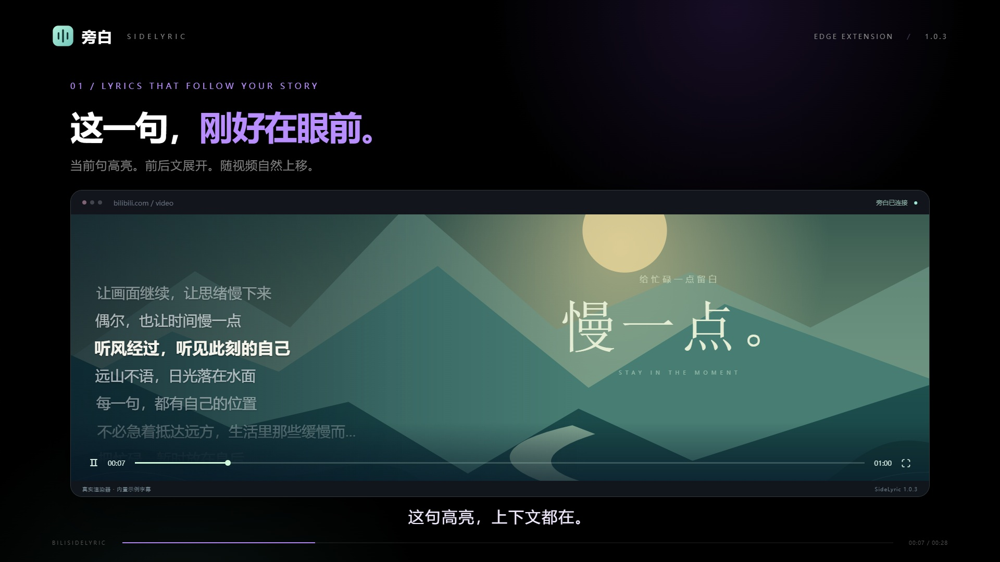

# 旁白 SideLyric

[](https://github.com/AFNW7/BiliSideLyric/actions/workflows/check.yml)

把 B 站字幕放在播放器左侧或右侧，像音乐软件的歌词一样随播放流动。原生 JavaScript、Manifest V3、无需安装依赖或构建，适用于 Edge 120+ 和支持 MV3 的 Chromium 浏览器。

[下载安装包](https://github.com/AFNW7/BiliSideLyric/releases/latest) · [观看宣传片（大肥鱼配音 · 28 秒）](https://github.com/AFNW7/BiliSideLyric/releases/download/v1.0.3/SideLyric-promo-fish-28s-1080p.mp4)

## 三分钟安装

1. 在 Edge 地址栏输入 `edge://extensions`。
2. 打开「开发人员模式」，点击「加载解压缩的扩展」。
3. 选择下载或克隆后的 `BiliSideLyric` 目录，确认目录内直接包含 `manifest.json`。
4. 刷新已经打开的 B 站视频页。新打开的投稿视频、分 P 和番剧播放页会自动连接。
5. 在 Edge 的扩展菜单固定「旁白」。点击图标打开设置，或把鼠标移动到播放器中歌词所在的一侧，点击「旁白」打开页内设置。

从 [GitHub Releases](https://github.com/AFNW7/BiliSideLyric/releases/latest) 下载 `SideLyric-1.0.3.zip` 运行文件包，解压到固定位置后加载其目录。安装不需要运行 `npm install`。本地打包产物位于 `release/`，不会写入 Git 历史。

### 更新到 1.0.3

「更多」中新增两个独立选项：「歌词位置」支持靠左 / 靠右，「字幕对齐」支持左对齐 / 居中 / 右对齐。选择位置后，底衬、控制条、提示与设置面板跟到对应一侧；「边缘留白」控制距该侧的距离，拖动手柄和双击复位同样有效。设置实时生效并同步保存，旧配置默认靠左、左对齐。

长句横向位置直接跟随 `video.currentTime`：按「本句起点 → 下一句起点」的时间比例，展示从句首到句尾的内容；最后一句使用自身结束时间。播放向前则单向推进，暂停停住，回退五秒按比例恢复，拖动到同一时刻会得到相同的位置；倍速和字幕偏移也同步生效。位置不再由独立动画或固定滚动速度控制。

1.0.1 修复了 AI 字幕地址没有 `.json` 后缀时被错误拦截的问题，保留完整的鉴权参数，并兼容协议相对地址和旧版 HTTP 地址。已找到字幕但下载失败时，会显示对应原因；无效地址不再反复自动重试。

如果扩展加载自本项目目录，更新文件后在 `edge://extensions` 点击「旁白」的重新加载按钮，再刷新 B 站视频页。如果加载自其他位置，把新版解压后的内容覆盖到该扩展目录，再执行同样的重新加载和刷新。

## 已完成的功能

- 自动读取字幕：优先 AI 中文，其次中文、英文，支持手动选择已有语言。
- 当前句放大高亮、前后文按距离变淡，纵向切句使用 transform；暂停不会跳句，拖动进度后重新定位。
- 自动按播放器高度分配前后文，带 1.5 秒迟滞；也可设置前后各 1–8 句。
- 歌词区域可靠左 / 靠右，字幕文字可左对齐 / 居中 / 右对齐，两者独立设置。
- 超长句按播放时间单向推进，暂停与回退同步，提供换行与省略模式。换行最多三行，并扩大行槽防止重叠。
- 检测左右黑边，优先把歌词放入黑边；跟随普通、宽屏、网页全屏和原生全屏。PiP 隐藏歌词。
- Popup 与播放器内设置共用一套控件；拖动实时预览，松开后写入 `chrome.storage.sync`，所有视频页同步更新。
- SRT / LRC 导入，自动为当前视频或分 P 保存在本机；最近五份本地字幕可刷新恢复。
- 可拖动控制条最右侧的手柄调整所选一侧的边缘留白，双击复位到 24 px。
- 减少动态效果模式、键盘操作、焦点样式、状态提示。

## 宣传片与效果预览



`promo/` 包含 28 秒宣传片的可编辑分镜、bibibobo 大肥鱼配音生成脚本、原创配乐和逐帧导出工具。运行本地预览后访问 `/promo/index.html`，可查看宣传片分镜；有声成片与再生成方法见 [宣传片说明](promo/README.md)。

## 如何使用

鼠标移到播放器中歌词所在的一侧，控制条会显示三秒。歌词文字本身不拦截点击，不影响暂停视频和 B 站进度条。控制条的眼睛按钮切换歌词开关；「旁白」打开设置。

设置分为「外观」「同步」「更多」。字幕跟声音不一致时，在「同步」中微调时间轴：**正值提前显示，负值延后显示**。需要本地字幕时从这里导入 SRT / LRC；「移除本地字幕，恢复在线获取」可回到自动模式。

快捷键：

| 快捷键 | 操作 |
|---|---|
| `Alt+L` | 全局显示 / 隐藏歌词（可在 `edge://extensions/shortcuts` 更改） |
| `Alt+[` / `Alt+]` | 视频页内调整偏移 −0.2 / +0.2 秒 |
| `Esc` | 在页内设置面板中关闭面板 |

开关及外观配置作用于所有支持的视频页。本地导入的字幕只对应当前视频 / 当前分 P，存入 `chrome.storage.local`，不会上传到同步空间。

## 先体验界面

运行 `npm run demo`，访问 `http://127.0.0.1:4173`。演示页使用内置示例时间轴，复用扩展的真实渲染器与设置控件，支持拖动进度、全屏、长句演示和本地导入。它不播放 B 站视频、不读取账号。

## 字幕获取与降级

1. MAIN world 脚本读取页面 `__INITIAL_STATE__`，提取当前视频 / 分 P / 番剧集信息。状态缺失或与 URL 不符时，后台通过投稿或番剧接口解析。
2. 后台读取 WBI 图片密钥，在本地计算 MD5 签名；先请求 `/x/player/wbi/v2`，再回退 `/x/player/v2`。
3. 字幕列表与正文先由页面上下文携带当前登录凭据请求；遇到 CORS 或页面请求失败时由 service worker 重试。后台只允许 B 站指定 API 与 `*.hdslb.com`，字幕内容按 JSON 解析，不要求 URL 有文件后缀。
4. 未获得时间轴时提示「请在播放器内开启 AI 字幕后重试」，每隔五秒再尝试，最多三次；用户可以手动再次重试。
5. 接口不可用时观察站内已开启的字幕，按文本变化和视频时间采集。此模式会明确标注「实时采集」，只含已播放的部分；不能预知未来字幕。

## 已知限制

- B 站使用非官方接口，WBI、字幕 URL、页面 DOM 或风控规则可能变化。扩展不绕过登录、付费或地区限制。
- **AI 字幕通常要求先登录 B 站，并且该视频本身存在、当前账号有权查看字幕。** 没有可用字幕的视频不会凭空生成字幕。
- 本次使用独立、未登录的 Edge 配置检查了两个真实 B 站视频：播放器连接正常，接口未提供字幕时显示提示，无扩展脚本异常。登录后的真实 AI 字幕及番剧账号权限未在本环境核验。
- 番剧和分 P 的时间轴链路已用浏览器夹具验证；不同番剧、播放器实验版仍可能需要更新选择器。
- `.sl-line` 只创建当前窗口和两端各一个动画缓冲节点；使用固定高度三行槽处理换行，超出三行的句子会省略。
- 不支持直播；画中画时隐藏。极小播放器会压缩可读区域，可以降低字号或关闭歌词。
- 短暂切换视频清晰度只重新绑定 video 元素，不会丢失当前时间轴；更换视频、分 P 或 cid 时重新加载。
- `chrome.storage.sync` 的设备同步速度由浏览器决定；当前设备实时预览不依赖云端同步。
- 模拟 30 分钟时间轴推进不等于真实播放 30 分钟。真实长播、长时间堆内存和掉帧仍需实际观看验证。

## 配置

配置直接存储在 `chrome.storage.sync`，字段保持需求约定：

| 字段 | 默认值 | 范围 / 说明 |
|---|---|---|
| enabled | true | 总开关 |
| fontSize | 20 | 12–40 px |
| lineHeight | 1.4 | 1.1–2.0 |
| opacity | 0.95 | 0.2–1 |
| maxWidthPct | 42 | 20–60%，同时不超过 520 px |
| overflowMode | scroll | scroll / wrap / clip |
| scrollSpeed | 60 | 旧配置兼容字段；时间同步滑动不使用该值，界面已移除固定速度设置 |
| contextLines | auto | auto / 1–8 |
| offsetSec | 0 | −3.0–3.0 s，步进 0.1 s |
| leftPadding | 24 | 0–240 px，所选一侧的边缘留白；沿用旧字段名，双击手柄复位 |
| placement | left | left / right，歌词区域位于播放器哪一侧 |
| textAlign | left | left / center / right，字幕文字的对齐方式 |
| showBg | false | 额外的半透明底衬 |
| hideInFullscreen | false | 原生 / 网页全屏隐藏 |

## 开发与自测

运行扩展不需要 Node.js。以下命令供开发验证使用，Node.js 20+：

```powershell
npm test
npm run check
npm run demo
```

浏览器回归脚本使用 Playwright 和本机 Edge，不进入扩展运行包。已安装 Playwright 时执行 `node tools/smoke.mjs`；也可设置 `SIDELYRIC_PLAYWRIGHT_PATH` 为已有 Playwright 包的绝对路径，`SIDELYRIC_BROWSER_PATH` 为 Edge 可执行文件路径。

- `tools/smoke.mjs`：使用独立临时配置加载真实扩展，以接口夹具检查投稿 / 分 P / 番剧、字幕渲染、设置延迟、全屏、导入、DOM 兜底、减少动画和模拟长播。
- `tools/subtitle-regression.mjs`：无后缀 AI 字幕地址、完整鉴权参数、HTTP 升级、MAIN world 请求失败后的后台接管；可用 `SIDELYRIC_EXTENSION_ROOT` 指定待测的解压扩展目录。
- `tools/preview-check.mjs`：本地演示启动后检查桌面 / 平板布局并生成截图。
- `tools/live-check.mjs`：在独立未登录配置中访问真实 B 站页面，记录实际状态；网络或账号条件会影响结果。
- `tests/core.test.js`：时间轴、解析、WBI、配置校验、请求白名单和视频身份解析。
- `TESTING.md`：本次验证结果与未完成实测项。

## 文件结构

```text
manifest.json            Edge / Chromium MV3 入口
assets/                  本地图标
src/background/          受限网络代理、WBI 签名、视频身份解析
src/content/             生命周期、字幕来源、时间轴、Shadow DOM 渲染
src/shared/              配置定义、设置控件、图标、请求校验
src/styles/              歌词层和共享设置样式
src/popup/               工具栏设置面板
demo/                    可交互的本地播放器演示
tests/                   核心测试和浏览器页面夹具
tools/                   本地预览、检查和回归脚本
```

所有运行代码均打包在本地，没有远程代码、第三方运行依赖、遥测或额外账号服务。host permissions 用于 B 站字幕 API 与字幕 CDN；`activeTab` 只用于把 Popup 与当前视频页连接。
