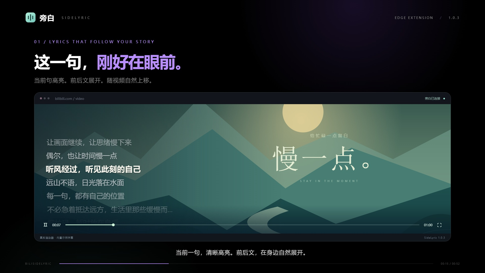

# 旁白 SideLyric 宣传片

一支 52 秒、1920×1080、24 fps 的中文产品宣传片。以黑底、紫色标题、黄色提示与产品原有薄荷绿组成视觉语言。八段分镜依次展示观看痛点、歌词高亮、时间同步的长句滑动、回退五秒、位置与文字对齐、外观设置，以及安装入口。



## 观看

- 成片：`output/SideLyric-promo-1080p.mp4`。
- 在线下载：[1080p MP4](https://github.com/AFNW7/BiliSideLyric/releases/download/v1.0.3/SideLyric-promo-1080p.mp4)。
- 本地交互分镜：在项目根目录运行 `npm run demo`，访问 `http://127.0.0.1:4173/promo/index.html`。
- `Space` 播放 / 暂停，左右方向键跳转分镜，拖动底部进度条精确查看任意时刻。

## 素材与真实性

播放器中的字幕使用扩展本身的 `Renderer`，横向进度与示例视频时间绑定。山水图形复用项目内原创 SVG；演示不包含第三方视频、音乐或 B 站账号数据。示例字幕用于展示交互，不能代表任意视频都能获取 AI 字幕。

音乐由 `audio.py` 本地合成，旁白来自 Windows 自带中文语音。成片带画内字幕，另提供 `captions.srt`。素材无需访问外部字体、图库或语音服务。

## 重新导出

需要 Node.js 20+、Playwright、本机 Edge，以及 Python 的 `numpy` 和 `imageio-ffmpeg`。这些仅为视频制作工具，扩展运行不需要它们。

```powershell
powershell -ExecutionPolicy Bypass -File promo/narration.ps1
python promo/audio.py
node promo/export.mjs --stills
node promo/export.mjs
```

已有 Playwright 包可通过 `SIDELYRIC_PLAYWRIGHT_PATH` 指定绝对路径；FFmpeg 可由 `SIDELYRIC_FFMPEG_PATH` 指定。使用其他本地预览地址时设置 `SIDELYRIC_PREVIEW_URL`。

`storyboard.json` 保存分镜时间和旁白，`promo.js` 用统一时间轴驱动画面，`export.mjs` 逐帧渲染并压制 H.264 / AAC MP4。`output/` 中的音频、预览和成片是可再生成产物，已加入 `.gitignore`；分镜、代码、字幕和封面会上传到仓库。
